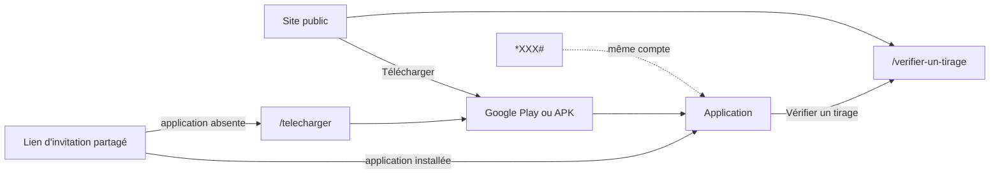

# Architecture de l'information

Ce document décrit ce que chaque public voit, comment c'est organisé et comment c'est nommé : arborescence du site public, de l'application mobile, du menu USSD et du back-office, vocabulaire et système de statuts. Les parcours détaillés sont dans [`user-flows.md`](user-flows.md), les besoins dans [`user-stories.md`](user-stories.md).

Sources : cahier des charges, section 4.2 ; [`audit/06-go-to-market-communication.md`](audit/06-go-to-market-communication.md), sections 3 à 5 ; [`architecture-systeme.md`](architecture-systeme.md).

## 1. Publics

| Public                         | Surface                    | Ce qu'il cherche                                                    |
| ------------------------------ | -------------------------- | ------------------------------------------------------------------- |
| Visiteur grand public          | Site public                | Comprendre, se rassurer, installer l'application                    |
| Présidente de tontine          | Site public, application   | Faire passer son groupe sur Mitemo sans perdre la main              |
| Membre avec smartphone         | Application                | Savoir où en est son argent, payer à l'heure, recevoir sa cagnotte  |
| Membre avec téléphone simple   | USSD                       | Consulter son solde, accepter ou annuler une échéance               |
| Jury, partenaire, journaliste  | Site public                | Vérifier le sérieux : partenaire agréé, tirage prouvable            |
| Personnel Mitemo               | Back-office                | Contrôler l'intégrité, aider un membre, traiter un litige           |

## 2. Principes

1. **Deux discours séparés.** Le site et l'application parlent à l'utilisatrice, sans vocabulaire technique. Le back-office et les pages « Sécurité » peuvent employer les termes exacts (`audit/06`, section 4).
2. **La confiance est visible partout** : partenaire agréé, frais affichés avant chaque validation, tirage vérifiable.
3. **Disponible et engagé, toujours séparés.** Un solde n'est jamais affiché seul (`audit/05`, section 3.5).
4. **Le statut n'est jamais porté par la seule couleur** : couleur, icône et mot (`audit/06`, section 5).
5. **Une action financière, un écran, une confirmation.** Les frais et le montant sont visibles avant la validation, jamais après.
6. **Pictogrammes d'abord, texte court ensuite.** Messages audio en lingala et kituba dans l'application (phase 1).

## 3. Vocabulaire

### 3.1 Termes affichés à l'utilisatrice

| Notion technique                  | Terme affiché                  |
| --------------------------------- | ------------------------------ |
| Portefeuille, `WALLET_USER`       | Mon coffre                     |
| Solde disponible                  | Disponible                     |
| Solde engagé (garantie, échéance) | Mis de côté                    |
| Tontine, groupe d'épargne         | Ma tontine                     |
| Cagnotte, `POT_TONTINE`           | La cagnotte                    |
| Tour, round                       | Tour                           |
| Garantie, `GUARANTEE_MEMBER`      | Ma garantie                    |
| Approvisionnement                 | Mettre de l'argent             |
| Retrait                           | Retirer                        |
| Arbitrage Accepter                | Payer maintenant               |
| Arbitrage Annuler                 | Plus tard                      |
| Tirage commit-reveal              | Tirage au sort vérifiable      |
| Empreinte `H(S)`                  | Code de contrôle du tirage     |
| Scoring                           | Mon historique (phase 3)       |
| Commission                        | Frais Mitemo                   |

Mots à ne jamais afficher à l'utilisatrice : fintech, plateforme, protocole, algorithme, grand livre, scoring, solvabilité, inclusion financière (`audit/06`, section 4).

Les libellés « Payer maintenant » et « Plus tard » sont proposés pour remplacer « Accepter » et « Annuler », qui disent mal ce qui se passe. À tester en entretien terrain avant de figer.

### 3.2 Système de statuts

| Niveau | Couleur | Icône proposée   | Mot affiché   | Statuts techniques correspondants             |
| ------ | ------- | ---------------- | ------------- | --------------------------------------------- |
| Bon    | Vert    | coche dans un cercle | À jour    | `ACTIF`                                        |
| Alerte | Orange  | horloge          | En attente    | `GELE_24H`, `EN_ATTENTE`, transaction `PENDING` |
| Incident | Rouge | triangle         | Incident      | `INCIDENT`, `EXCLU`, transaction `FAILED`     |
| Neutre | Gris    | point            | Pas commencé  | `INVITE`, `ACCEPTE`, tontine en `RECRUTEMENT` |

## 4. Site public

### 4.1 Arborescence

```
/                               Accueil
├── /comment-ca-marche          Le cycle en quatre étapes
├── /securite                   Où est l'argent, tirage vérifiable, ce que Mitemo ne fait pas
├── /frais                      Frais Mitemo, exemple chiffré, ce qui est gratuit
├── /presidentes                Pour celles qui tiennent une tontine (Ambassadrices, phase 1)
├── /questions                  Questions fréquentes
├── /telecharger                Google Play, APK direct, configuration minimale
├── /verifier-un-tirage         Vérification publique d'un tirage
├── /contact                    Téléphone du support, point physique, adresse
└── /legal
    ├── /mentions-legales
    ├── /confidentialite
    └── /conditions             CGU et règlement de groupe type
```

Le back-office (`/admin`) n'est lié depuis aucune page publique et n'est pas indexé.

### 4.2 Contenu par page

| Page                   | Message principal                                                       | Action principale       |
| ---------------------- | ----------------------------------------------------------------------- | ----------------------- |
| Accueil                | « Votre tontine, en sécurité, sans frais entre vous. » (`audit/06`)     | Télécharger             |
| Comment ça marche      | Créer, inviter, mettre de côté, recevoir sa cagnotte                     | Télécharger             |
| Sécurité               | Fonds chez un partenaire agréé, tirage que personne ne peut truquer, ce que Mitemo ne fait pas | Vérifier un tirage |
| Frais                  | Ce qui est payant, ce qui est gratuit, un exemple réel                   | Télécharger             |
| Présidentes            | Garder la main sur son groupe, sans cahier ni argent liquide             | Nous appeler            |
| Questions              | « Et si vous partiez avec notre argent ? » en première question          | Nous appeler            |
| Vérifier un tirage     | Saisir le numéro du tirage, voir le code de contrôle et l'ordre recalculé | Vérifier               |
| Contact                | Un humain qui répond, un lieu dans le marché                             | Appeler                 |

**Exemple chiffré de la page Frais** (convention de cagnotte B, `audit/03`, section 3.1) : 10 membres, 5 000 FCFA par tour. Chaque tour, la cagnotte vaut 45 000 FCFA ; les frais Mitemo sont de 675 FCFA ; la bénéficiaire reçoit 44 325 FCFA. La grille tarifaire définitive dépend de `audit/01-modele-economique.md` : cette page ne se publie qu'avec des chiffres validés.

Tant qu'aucun partenaire agréé n'a signé, la page Sécurité ne cite **aucun nom** de partenaire.

### 4.3 Navigation

- En-tête : logo, Comment ça marche, Sécurité, Frais, Questions, bouton **Télécharger**.
- Pied de page : Présidentes, Vérifier un tirage, Contact, pages légales, langue.
- Sur mobile : menu replié, bouton Télécharger toujours visible.

## 5. Application mobile

### 5.1 Arborescence

```
Bienvenue (non connecté)
├── Mon numéro
├── Code reçu par SMS
├── Créer mon code secret (PIN)
└── Confirmer mon code secret

Application (connecté), quatre onglets
├── Accueil
│   ├── Mon coffre : disponible, mis de côté
│   ├── Prochaine échéance : date, montant, statut
│   └── Ma tontine : tour en cours, bénéficiaire, progression
├── Ma tontine
│   ├── Détail : montant, fréquence, membres et leur statut
│   ├── Calendrier des tours
│   ├── Tirage : code de contrôle, ordre, Vérifier
│   ├── Inviter (présidente)
│   └── Créer une tontine (si aucune tontine active)
├── Mon coffre
│   ├── Mettre de l'argent
│   ├── Retirer (phase 1)
│   └── Historique des mouvements
└── Profil
    ├── Mon code secret
    ├── Mes appareils (phase 1)
    ├── Langue et messages audio (phase 1)
    ├── Aide : appeler le support
    └── Se déconnecter

Écrans déclenchés
├── Échéance : Payer maintenant, Plus tard
├── Invitation reçue (lien d'invitation)
├── Bloquer ma garantie
└── Confirmation d'opération
```

Phase 0 : une seule tontine par membre (`audit/07`, multi-tontines exclu). L'onglet « Ma tontine » affiche donc une tontine, ou l'invitation à en créer ou en rejoindre une.

### 5.2 Hiérarchie de l'écran d'accueil

1. Statut de l'échéance la plus proche (couleur, icône, mot).
2. Disponible et mis de côté.
3. Action attendue s'il y en a une (payer, bloquer sa garantie), sinon « Mettre de l'argent ».
4. Résumé de la tontine.

## 6. Menu USSD

Chaque écran tient en 160 caractères au plus. Le PIN est saisi dans la session.

```
*XXX#
1. Mon coffre          → Disponible : 12 500 FCFA. Mis de côté : 2 500 FCFA. 0. Retour
2. Mon échéance        → Tontine du marché, 5 000 FCFA, avant 18 h.
                          1. Payer maintenant  2. Plus tard  0. Retour
                          → Code secret : ****
                          → Payé. Statut : À jour.
3. Ma tontine          → Tour 4 sur 10. Prochain bénéficiaire : 06*****12. 0. Retour
0. Aide                → Support : numéro du support
```

Le numéro du bénéficiaire est masqué. Le code court `*XXX#` dépend de la négociation avec les opérateurs.

## 7. Back-office

### 7.1 Arborescence

```
/admin/connexion                Adresse, mot de passe, code à usage unique
/admin                          Intégrité (page d'accueil)
├── /admin/tontines             Liste filtrable par état
│   └── /admin/tontines/:id     Paramètres, membres, tours, tirage, historique des états
├── /admin/membres              Recherche par fin de numéro
│   └── /admin/membres/:id      Profil masqué, adhésions, coffre, appareils
├── /admin/ecritures            Grand livre, filtrable par compte et période
├── /admin/transactions         Approvisionnements et retraits par état
├── /admin/audit                Journal d'audit
├── /admin/litiges              (phase 1)
├── /admin/corrections          Propositions et validations (phase 1)
├── /admin/alertes              Réconciliation, LBC/FT (phase 1)
└── /admin/personnel            Comptes et rôles (rôle admin)
```

### 7.2 Page Intégrité

En tête, dans cet ordre :

1. Écart de réconciliation en FCFA, rouge s'il n'est pas nul.
2. Date de la dernière vérification.
3. Validité de la chaîne de hachage, et première écriture invalide le cas échéant.
4. Solde du compte `SUSPENSE`.
5. Transactions `PENDING` au-delà de leur délai.

### 7.3 Règles d'affichage

- Numéros masqués (`06*****12`). L'affichage complet est une action explicite, réservée à un rôle, et journalisée.
- Montants en FCFA entiers, alignés à droite, avec séparateur de milliers.
- Dates affichées à l'heure de Brazzaville, stockées en UTC.
- Aucune action d'écriture en phase 0.

## 8. Navigation entre surfaces



Un lien d'invitation est une adresse web : s'il est ouvert sans l'application, il mène à la page de téléchargement puis reprend l'invitation après l'installation.
