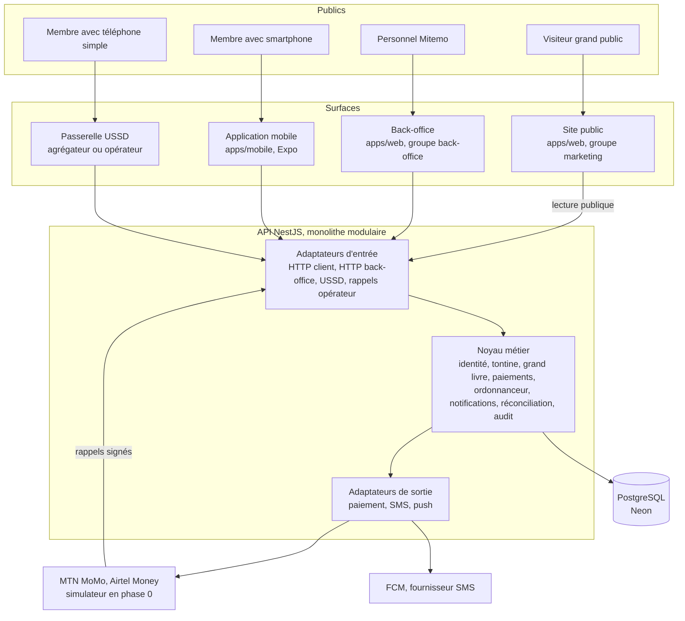
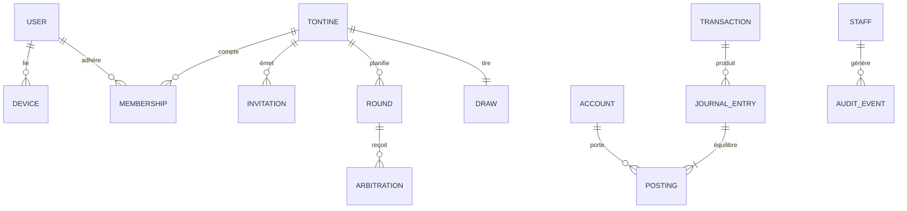
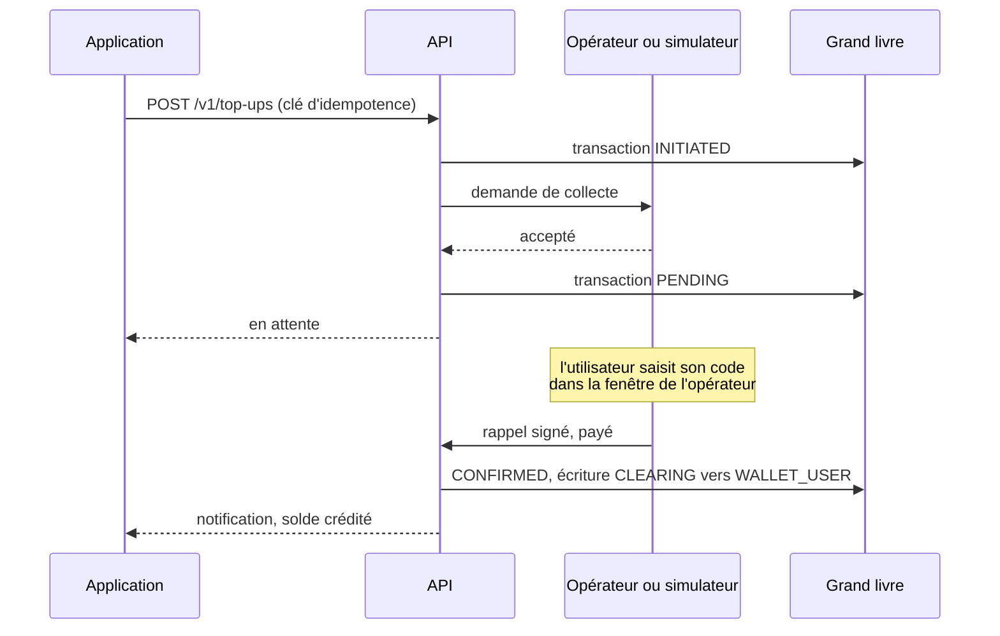
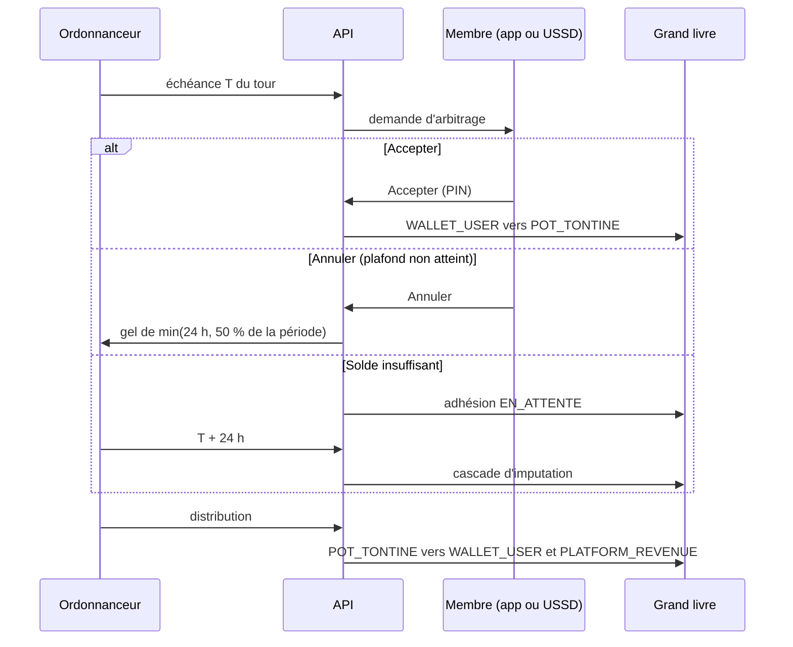

# Architecture système

Ce document décrit comment Mitemo est découpé : les surfaces exposées, le noyau métier, les données, les intégrations et l'authentification. Il traduit dans la stack retenue (`AGENTS.md`, section 1) les principes de [`audit/03-architecture-technique.md`](audit/03-architecture-technique.md), qui reste la référence sur les règles financières.

Statut des éléments :

- **Décidé** : déjà dans le dépôt ou fixé par `AGENTS.md`.
- **Proposé** : cohérent avec la documentation existante, à valider par un ADR avant d'être construit.
- La phase indiquée (0, 1, 2, 3) reprend [`audit/07-roadmap-et-perimetre.md`](audit/07-roadmap-et-perimetre.md).

## 1. Vue d'ensemble

Quatre surfaces, un seul noyau. Le noyau ne sait pas par quel canal une action arrive : l'arbitrage Accepter ou Annuler produit les mêmes écritures qu'il vienne de l'application ou de l'USSD (`audit/03`, section 4.5).

## 2. Surfaces

### 2.1 Site public (marketing)

| Élément       | Choix                                                                                                                       | Statut  |
| ------------- | --------------------------------------------------------------------------------------------------------------------------- | ------- |
| Emplacement   | `apps/web`, groupe de routes `src/app/(marketing)/`                                                                         | Proposé |
| Rendu         | Pages statiques générées au build, sauf la vérification de tirage                                                           | Proposé |
| Données       | Aucune donnée personnelle. Une seule lecture d'API : la vérification publique d'un tirage, par son identifiant               | Proposé |
| Langue        | Français simplifié, sans vocabulaire bancaire (`audit/06`, section 4)                                                       | Décidé  |
| Phase         | 0 : page vitrine, téléchargement, vérification de tirage. 1 : pages légales validées par un avocat, programme Ambassadrices | Proposé |

Le site n'a **pas d'espace membre**. Un membre agit dans l'application ou par USSD, jamais dans un navigateur : cela évite un second parcours d'authentification à sécuriser contre le *SIM swap*.

### 2.2 Back-office (administration)

| Élément       | Choix                                                                                                       | Statut  |
| ------------- | ----------------------------------------------------------------------------------------------------------- | ------- |
| Emplacement   | `apps/web`, groupe de routes `src/app/(back-office)/admin/`                                                 | Proposé |
| Rendu         | Rendu serveur à chaque requête, jamais mis en cache, `noindex`                                              | Proposé |
| Accès         | Personnel Mitemo uniquement, comptes nominatifs, voir section 6.2                                           | Proposé |
| Phase 0       | Consultation seule : tableau de bord d'intégrité, tontines, membres, écritures (issues #29 et #30)          | Décidé  |
| Phase 1       | Support complet, litiges, corrections manuelles à double validation, alertes LBC/FT (`audit/07`, phase 1)   | Décidé  |

**Pourquoi une seule application web pour deux publics** (proposé) : une équipe de deux personnes, un seul build, un seul jeu de composants partagés. La séparation se fait par groupe de routes, par contrôle de session côté serveur sur tout le groupe `(back-office)`, et par des endpoints d'API distincts (`/admin/...`) qui refusent tout jeton de membre. À réexaminer si le back-office doit être servi sur un domaine séparé ou derrière un réseau privé : c'est l'objet de l'ADR à écrire (section 9).

### 2.3 Application mobile

| Élément      | Choix                                                                                                         | Statut                   |
| ------------ | ------------------------------------------------------------------------------------------------------------- | ------------------------ |
| Technologie  | Expo SDK 58, Expo Router, React Native 0.88                                                                   | Décidé                   |
| Cible        | Android d'abord, iOS en phase 3 (`audit/03`, section 4.1)                                                      | Décidé                   |
| Distribution | Google Play et APK direct partageable                                                                         | Décidé (`audit/03`)      |
| Hors-ligne   | Consultation du solde, du calendrier et de l'historique sans réseau. Seule la confirmation de paiement exige la connexion | Décidé (`audit/03`), phase 1 |
| Données      | Stockage local chiffré, jeton de session dans le stockage sécurisé du système                                 | Proposé                  |

L'audit recommandait Flutter. Le dépôt utilise Expo : les exigences de l'audit (Android 7, APK léger, hors-ligne d'abord) restent valables et sont à vérifier sur le build Expo avant le pilote.

### 2.4 Passerelle USSD

Session initiée par l'utilisateur sur un code court. La passerelle de l'opérateur appelle l'API, qui répond par le texte de l'écran suivant. Phase 0 : simulateur (issue #20). Phase 1 : code court chez un opérateur, dont la négociation prend plusieurs mois (`audit/04`, section 3).

## 3. API : monolithe modulaire

Un seul déployable NestJS, découpé en features à frontières nettes (`AGENTS.md`, section 2.1). Pas de microservices (`audit/03`, section 4.2).

| Feature            | Responsabilité                                                                         | Issues   | Phase |
| ------------------ | -------------------------------------------------------------------------------------- | -------- | ----- |
| `identity`         | Enrôlement par numéro et OTP, PIN, appareils, sessions des membres                     | #9       | 0     |
| `staff-identity`   | Comptes du personnel, mot de passe et second facteur, rôles                            | #36      | 0     |
| `tontines`         | Création, paramètres, automate de la tontine                                           | #10      | 0     |
| `memberships`      | Invitations par jeton, automate de l'adhésion                                          | #11      | 0     |
| `guarantees`       | Blocage des garanties, quorum, restitution                                             | #12      | 0     |
| `draw`             | Tirage par mise en gage et révélation, vérification publique                           | #13      | 0     |
| `rounds`           | Tours, échéances, arbitrage Accepter ou Annuler, distribution, cascade de défaut       | #17 à #19 | 0     |
| `ledger`           | Écritures en partie double, chaîne de hachage, idempotence                             | #6 à #8  | 0     |
| `payments`         | Port de paiement unique, adaptateur simulateur puis opérateurs, automate de transaction | #14, #15 | 0     |
| `scheduler`        | File durable adossée à PostgreSQL, minuteries du cycle                                 | #16      | 0     |
| `notifications`    | Push, SMS, plafonds par utilisateur et par jour                                        | #39      | 0     |
| `ussd`             | Adaptateur de session USSD                                                             | #20      | 0     |
| `reconciliation`   | Comparaison grand livre et relevés, alertes                                            | #21      | 0     |
| `audit-trail`      | Journal d'audit distinct des journaux techniques, en écriture seule                    | #37      | 0     |
| `back-office`      | Endpoints de consultation pour le personnel                                            | #30      | 0     |
| `disputes`         | Procédure de litige                                                                    | #44      | 1     |
| `compliance`       | Paliers KYC, plafonds consolidés, surveillance LBC/FT                                  | à créer  | 1     |
| `health`           | Sonde de vie                                                                           | existant | 0     |

Règles de dépendance : celles de `AGENTS.md`, section 2.1. Une feature n'appelle pas les fichiers internes d'une autre : elle passe par ce que l'autre module exporte, ou par un événement.

### 3.1 Préfixes d'API

| Préfixe      | Appelant                             | Authentification              |
| ------------ | ------------------------------------ | ----------------------------- |
| `/v1/...`    | Application mobile                   | Jeton de membre lié à l'appareil |
| `/public/...` | Site public                         | Aucune, limitation de débit   |
| `/admin/...` | Back-office                          | Session du personnel et rôle  |
| `/ussd/...`  | Passerelle USSD                      | Signature de la passerelle    |
| `/webhooks/...` | Opérateurs de paiement            | Signature de l'opérateur, idempotence |
| `/health`    | Supervision                          | Aucune                        |

Les formes de requête et de réponse sont dans `@mitemo/contracts` (`AGENTS.md`, section 3.9).

## 4. Données

| Élément             | Choix                                                                                                                                       | Statut |
| ------------------- | ------------------------------------------------------------------------------------------------------------------------------------------- | ------ |
| Base                | PostgreSQL hébergé sur Neon, région Frankfurt                                                                                               | Décidé |
| Accès               | Prisma 7, adaptateur `@prisma/adapter-pg`                                                                                                   | Décidé |
| Connexions          | `DATABASE_URL` directe pour le grand livre et les migrations, `DATABASE_POOLED_URL` pour les lectures simples                                | Décidé |
| Montants            | `BIGINT`, francs CFA entiers, jamais de flottant                                                                                            | Décidé |
| Isolation           | `SERIALIZABLE` sur les écritures du grand livre, reprise sur conflit de sérialisation                                                       | Décidé |
| Contraintes en base | Somme nulle des imputations d'une écriture, unicité des clés d'idempotence, transitions d'état contrôlées (`audit/03`, section 4.3)          | Décidé |
| Conformité          | Copie de conformité en zone CEMAC avant la production réelle (`audit/04`, section 1)                                                        | Décidé, phase 1 |

Domaines de données et leurs tables principales (noms indicatifs, fixés par les migrations) :

Un solde n'est jamais stocké comme vérité : c'est la somme des imputations du compte (`audit/03`, section 1.1).

## 5. Flux critiques

### 5.1 Approvisionnement du portefeuille

Le portefeuille n'est jamais crédité sur une simple réponse 200 (`audit/03`, section 1.4). Un `PENDING` qui dépasse son délai est interrogé par l'ordonnanceur, jamais abandonné.

### 5.2 Échéance d'un tour

## 6. Authentification et autorisation

Deux populations, deux mécanismes, aucun jeton commun.

### 6.1 Membres (application et USSD)

| Étape              | Mécanisme                                                                                       | Statut                |
| ------------------ | ----------------------------------------------------------------------------------------------- | --------------------- |
| Enrôlement         | Numéro validé par `libphonenumber-js`, OTP par SMS, liaison de l'appareil                       | Décidé (`audit/03`)   |
| Usage courant      | PIN à six chiffres, haché en Argon2id, jamais récupérable                                       | Décidé                |
| Session            | Jeton d'accès court et jeton de renouvellement lié à l'appareil, révocable                      | Proposé               |
| Opérations de fonds | PIN redemandé à chaque arbitrage, retrait ou transfert                                         | Proposé               |
| Protection         | Limitation de débit et verrouillage progressif sur l'OTP et le PIN                             | Décidé                |
| Nouvel appareil    | Carence de 24 à 72 h avant toute sortie de fonds, notification à l'ancien appareil et par SMS   | Décidé, phase 1       |
| USSD               | PIN saisi dans la session, aucun arbitrage par SMS sans PIN                                     | Décidé (`audit/03`, section 4.5) |

### 6.2 Personnel (back-office)

La documentation existante ne décrit pas l'accès du personnel. Proposition :

| Élément        | Proposition                                                                                                        |
| -------------- | ------------------------------------------------------------------------------------------------------------------ |
| Comptes        | Nominatifs, créés par un administrateur. Aucune inscription publique                                               |
| Identifiants   | Adresse électronique professionnelle, mot de passe haché en Argon2id                                               |
| Second facteur | Obligatoire dès la phase 0 (code TOTP)                                                                             |
| Session        | Cookie `HttpOnly`, `Secure`, `SameSite=Strict`, durée courte, expiration à l'inactivité                            |
| Journal        | Chaque connexion, consultation de membre et action est écrite au journal d'audit                                   |
| Données        | Numéros de téléphone masqués par défaut, affichage complet sur action explicite et journalisée                     |

Rôles proposés (moindre privilège) :

| Rôle          | Peut                                                                                  | Phase |
| ------------- | ------------------------------------------------------------------------------------- | ----- |
| `viewer`      | Consulter tontines, membres masqués, écritures, intégrité                             | 0     |
| `support`     | Consulter, ouvrir et suivre un litige, voir un numéro complet (journalisé)           | 1     |
| `finance`     | Proposer une correction du grand livre, suivre la réconciliation                      | 1     |
| `compliance`  | Traiter les alertes LBC/FT, préparer une déclaration de soupçon                       | 1     |
| `admin`       | Gérer les comptes du personnel et leurs rôles                                         | 0     |

Toute correction manuelle du grand livre exige **deux comptes distincts** : l'un propose, l'autre valide, avec motif obligatoire et contre-écriture, jamais de suppression (`audit/03`, section 4.7).

## 7. Sécurité transverse

- TLS sur toutes les connexions, y compris vers les opérateurs.
- Toute entrée externe validée à la frontière (`AGENTS.md`, section 4).
- Rappels opérateur et passerelle USSD : signature vérifiée, idempotents, rejouables.
- Journaux structurés sans PIN, OTP, jeton ni numéro complet.
- Secrets hors du dépôt, listés dans les `.env.example`.
- Audit de sécurité externe avant la phase 1 (`audit/04`, section 5).

## 8. Environnements et observabilité

| Environnement | Branche   | Base                               | Paiement             |
| ------------- | --------- | ---------------------------------- | -------------------- |
| Développement | locale    | branche Neon par développeur       | simulateur           |
| Recette       | `staging` | branche Neon de recette            | simulateur, puis bac à sable opérateur |
| Production    | `main`    | base Neon de production            | opérateur réel (phase 1) |

Hébergement de l'API et du web : non décidé. L'audit recommande Scaleway Paris (`audit/04`, section 1), à trancher par un ADR en tenant compte de la base Neon à Frankfurt.

Observabilité prévue : Sentry pour les erreurs (`@sentry/nestjs`, `AGENTS.md`, section 8.1), journaux structurés (`nestjs-pino`), sonde `/health` (`@nestjs/terminus`), supervision externe.

## 9. Décisions à prendre (ADR)

| Sujet                                                        | Options                                                            |
| ------------------------------------------------------------ | ------------------------------------------------------------------ |
| Site public et back-office : une application ou deux         | Groupes de routes dans `apps/web` (proposé) ou `apps/admin` séparée |
| Domaine du back-office                                       | Même domaine sous `/admin`, ou sous-domaine dédié                  |
| Authentification du personnel                                | Implémentation maison (proposé ci-dessus) ou fournisseur d'identité |
| File durable de l'ordonnanceur                               | `pg-boss` ou table `due_at` avec travailleur élu (issue #16)       |
| Hébergement de l'API et du web                               | Scaleway Paris (audit) ou autre                                    |

Chaque décision s'appuie sur des sources vérifiées (version, maintenance, licence, avis de sécurité), conformément à `AGENTS.md`.
