# Parcours utilisateur (user flows)

Chaque parcours décrit les écrans, les décisions et les sorties d'erreur d'une tâche précise. Les règles métier citées viennent du cahier des charges et de [`audit/03-architecture-technique.md`](audit/03-architecture-technique.md) ; l'organisation des écrans de [`architecture-information.md`](architecture-information.md).

| N° | Parcours                                   | Surface      | Phase | Issues      |
| -- | ------------------------------------------ | ------------ | ----- | ----------- |
| 1  | Découvrir Mitemo et installer l'application | Site public  | 0     | #46         |
| 2  | Vérifier un tirage                         | Site, app    | 0     | #38, #47, #26 |
| 3  | S'inscrire                                 | Application  | 0     | #9, #23     |
| 4  | Se reconnecter                             | Application  | 0     | #9, #23     |
| 5  | Changer de téléphone                       | Application  | 1     | #40, #51    |
| 6  | Créer une tontine et inviter               | Application  | 0     | #10, #11, #24 |
| 7  | Rejoindre une tontine                      | Application  | 0     | #11, #12, #25 |
| 8  | Mettre de l'argent dans son coffre         | Application  | 0     | #15, #27    |
| 9  | Régler une échéance                        | Application  | 0     | #17, #28    |
| 10 | Régler une échéance par USSD               | USSD         | 0     | #20         |
| 11 | Défaut et cascade                          | Système      | 0     | #19         |
| 12 | Recevoir sa cagnotte                       | Application  | 0     | #18         |
| 13 | Se connecter au back-office                | Back-office  | 0     | #36, #48    |
| 14 | Contrôler l'intégrité                      | Back-office  | 0     | #21, #29    |
| 15 | Aider un membre                            | Back-office  | 0     | #30         |

## 1. Découvrir Mitemo et installer l'application

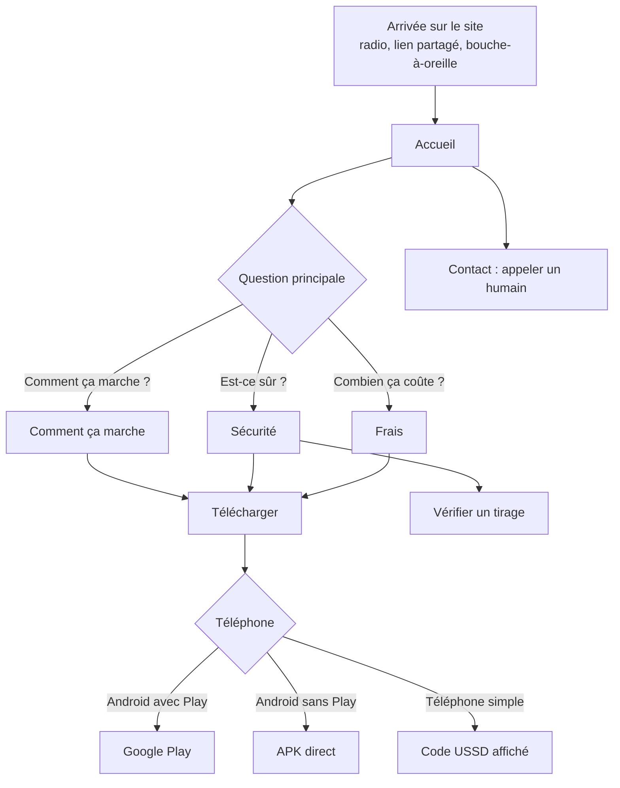

Sorties : installation, appel au support, ou code USSD noté. Aucune inscription sur le site.

## 2. Vérifier un tirage

Règle : `audit/03`, section 3.4. Le code de contrôle `H(S)` est publié 48 h avant le tirage ; la graine `S` est révélée au tirage.

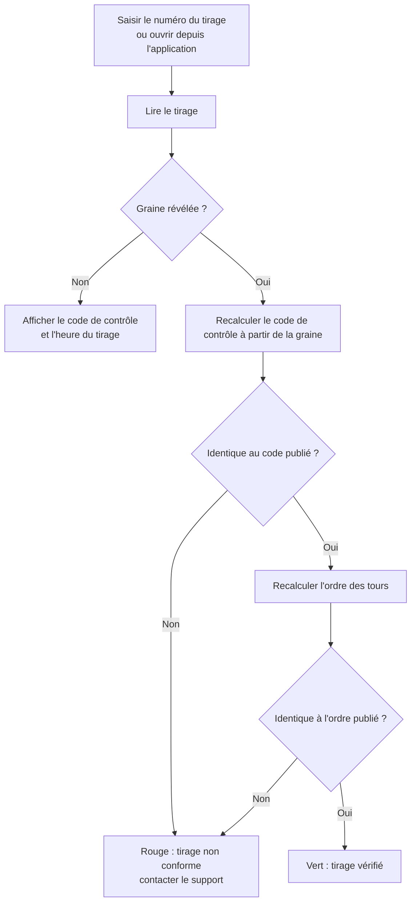

Le calcul de vérification se fait côté client (navigateur ou téléphone), à partir de données publiques : il ne demande pas de faire confiance au serveur de Mitemo. Les membres sont identifiés par un identifiant opaque, jamais par leur numéro.

## 3. S'inscrire

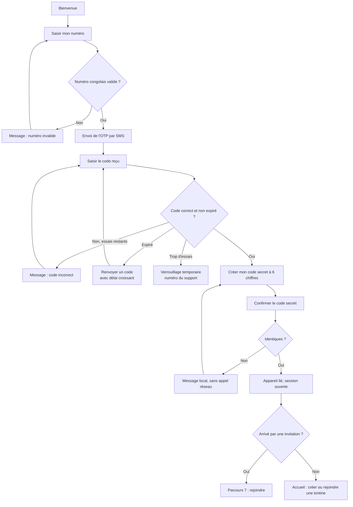

Règles : le code secret refuse les suites évidentes (`123456`, `000000`) ; il est haché en Argon2id et n'est jamais récupérable.

## 4. Se reconnecter

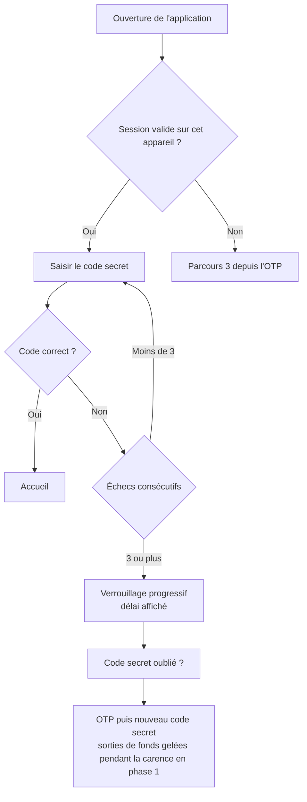

## 5. Changer de téléphone (phase 1)

Le parcours le plus difficile du produit, volontairement (`audit/03`, section 4.6).

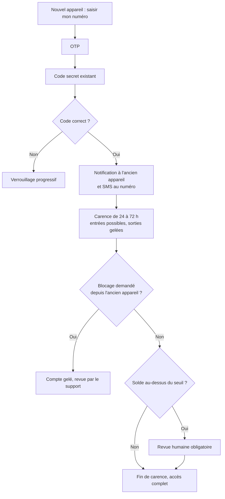

## 6. Créer une tontine et inviter

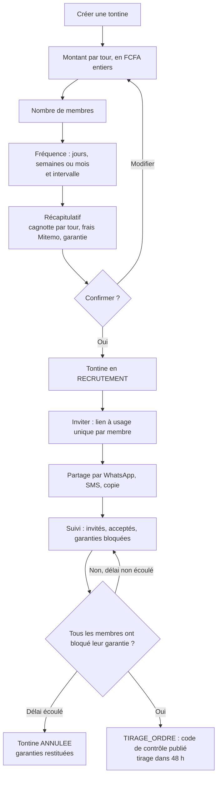

Exemple affiché au récapitulatif : 10 membres, 5 000 FCFA par tour, cagnotte de 45 000 FCFA, frais de 675 FCFA, la bénéficiaire reçoit 44 325 FCFA, garantie de 2 500 FCFA par membre.

Phase 1 : la présidente doit être au palier KYC 1 et désigner une co-administratrice (`audit/05`, section 2.1). Les cagnottes des groupes sans historique sont plafonnées (`audit/05`, section 2.5).

## 7. Rejoindre une tontine

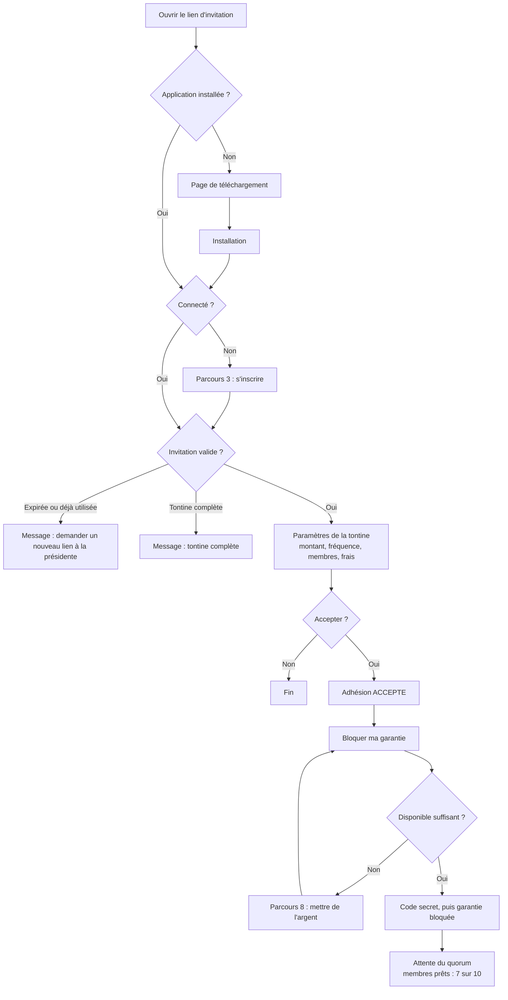

## 8. Mettre de l'argent dans son coffre

Règle : le coffre n'est crédité qu'à la confirmation de l'opérateur (`audit/03`, section 1.4).

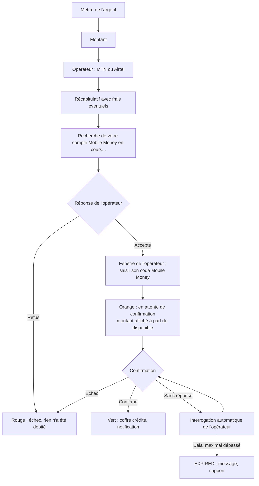

Une double saisie ou un double appui ne crédite jamais deux fois : chaque demande porte une clé d'idempotence générée par l'application.

## 9. Régler une échéance

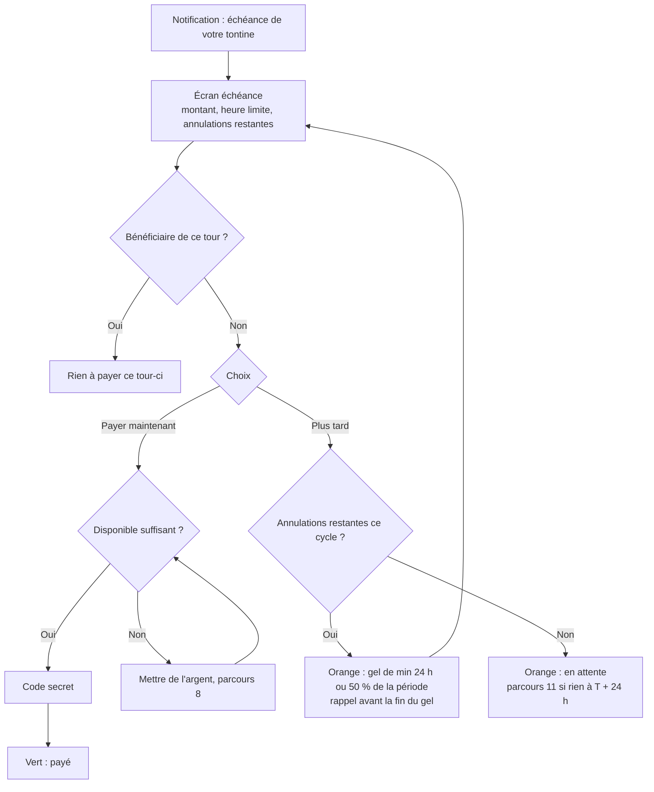

Le bouton « Plus tard » n'est pas proposé à la bénéficiaire du tour. Sur un cycle journalier, le gel dure 12 heures (`audit/03`, section 3.3).

## 10. Régler une échéance par USSD

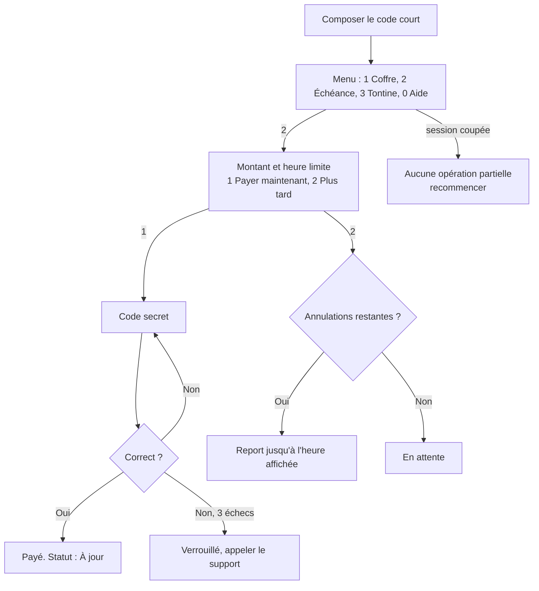

Un SMS de confirmation est envoyé après chaque paiement : c'est un message critique et non répudiable (`audit/04`, section 3).

## 11. Défaut et cascade (système)

Règle : `audit/03`, section 3.2. Manque à combler `M`.

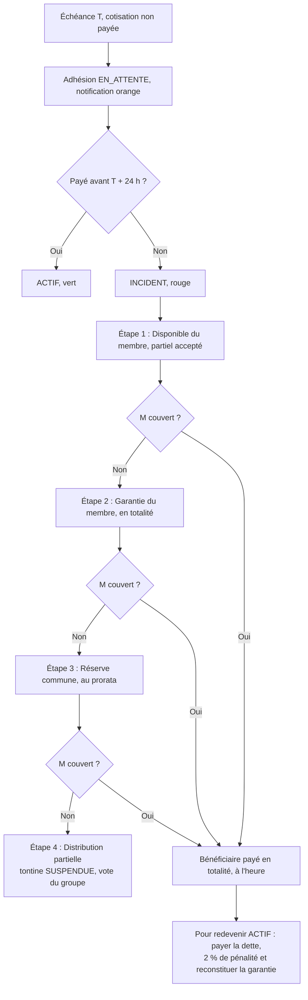

Exemple : cotisation de 5 000 FCFA, pénalité de 100 FCFA. Un membre ne doit jamais être pénalisé pour une lenteur de l'opérateur (`audit/05`, section 3.2).

## 12. Recevoir sa cagnotte

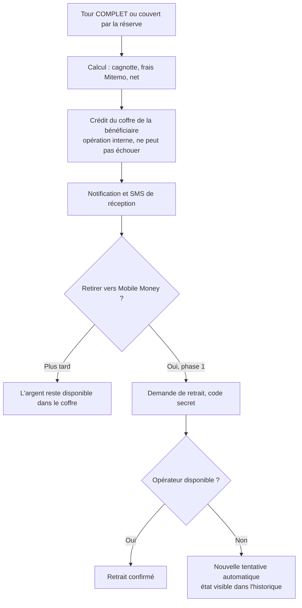

Le versement externe est une demande séparée et réessayable : une panne de l'opérateur ne bloque jamais la distribution (`audit/05`, section 3.1).

## 13. Se connecter au back-office

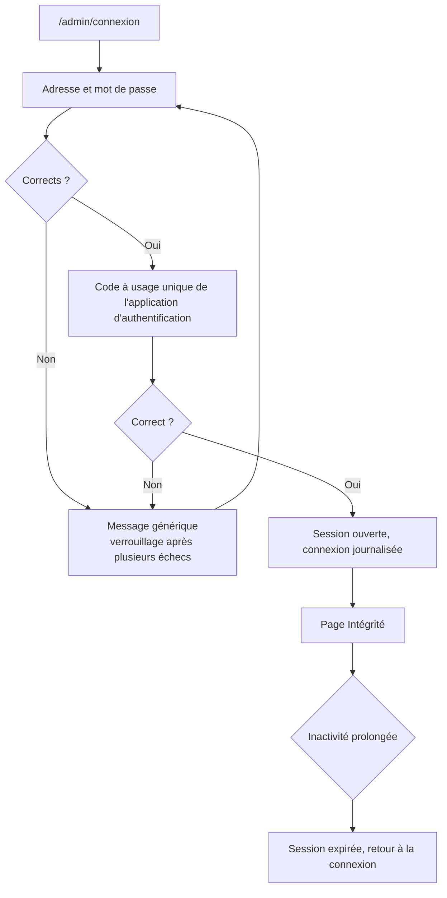

Le message d'échec ne dit jamais si c'est l'adresse ou le mot de passe qui est faux. Les comptes sont créés par un administrateur, il n'existe pas de page d'inscription.

## 14. Contrôler l'intégrité

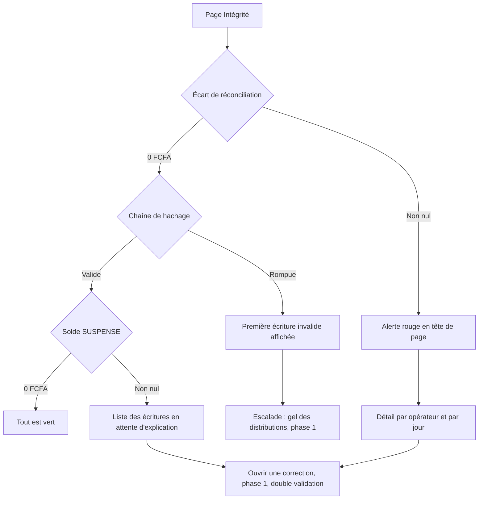

## 15. Aider un membre

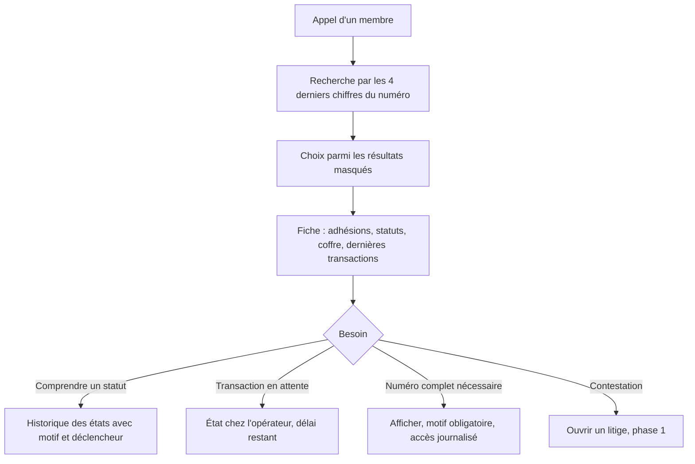

En phase 0, le back-office ne permet aucune action d'écriture.
